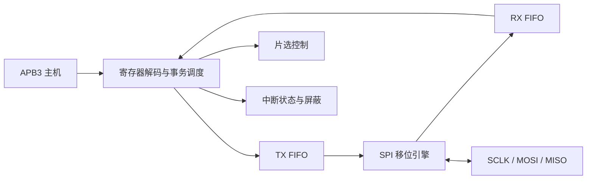

# 结构与时序

## 模块分工

`apb_spi_master.sv` 负责 APB 访问、寄存器、FIFO 调度、片选和中断。
`spi_shift.sv` 只负责单个字节的串并转换与 SPI 边沿。
`sync_fifo.sv` 为收发共用的参数化队列实现。

RTL 使用 SystemVerilog 的 `logic` 声明信号，以 `always_ff` 描述时序逻辑，
以 `always_comb` 和连续赋值描述组合逻辑。

三个模块只使用 PCLK。SCLK 是一个带时钟使能效果的寄存器输出，不用于驱动
任何内部 `always_ff @(posedge spi_sclk)` 逻辑。这样内部时序只有一个时钟域。

## APB 访问

一次传输必须经历 SETUP（PSEL=1、PENABLE=0），然后 ACCESS
（PSEL=1、PENABLE=1）。本设计 PREADY 恒为 1，因此 ACCESS 只需一拍。
仅在 PCLK 上升沿满足 `PSEL && PENABLE && PREADY` 时产生寄存器/FIFO 副作用。
连续访问可保持 PSEL 为 1，但各次 ACCESS 之间仍要有 SETUP。

地址按 4 字节对齐；没有 PSTRB，TXDATA 只取低 8 位。空 RX 读取和满 TX 写入
返回 PSLVERR；不阻塞 APB，以便软件读取状态并恢复。错误只在 ACCESS 阶段输出。
所有寄存器位置与非法写入行为以 [specification.md](specification.md) 为准。

## 四种 SPI 模式

| 模式 | CPOL | CPHA | 空闲 SCLK | 采样边沿 | 更新数据边沿 |
|---|---:|---:|---|---|---|
| 0 | 0 | 0 | 低 | 上升 | 下降 |
| 1 | 0 | 1 | 低 | 下降 | 上升 |
| 2 | 1 | 0 | 高 | 下降 | 上升 |
| 3 | 1 | 1 | 高 | 上升 | 下降 |

引擎用 `edge_index` 标记每个字节的 16 个边沿。偶数为离开空闲电平的 leading
edge，奇数为回到空闲电平的 trailing edge。CPHA=0 在 leading edge 采样，
CPHA=1 在 trailing edge 采样。CPHA=0 的首位在第一个采样边沿之前就准备好。
模式定义可对照 [Analog Devices 的 SPI 说明](https://www.analog.com/en/resources/analog-dialogue/articles/introduction-to-spi-interface.html)。

DIVIDER 表示每个 SCLK 半周期包含多少个 PCLK 周期。PCLK=100 MHz、DIVIDER=5
时，字节内 SCLK 为 10 MHz；DIVIDER=1 时为 50 MHz。该计算只描述 RTL 波形，
外部器件能否使用该频率还取决于时钟到输出、板线延迟和建立保持时间。

## FIFO 与事务调度

FIFO 使用首字直通输出：非空时，dout 始终指向队首；pop 在时钟沿推进读指针。
无须先 pop 再等待一个读延迟，SPI 引擎可在同一拍取得队首并发起发送。
深度要求为 2 的幂，指针自然回绕；计数器比地址指针多一位，区分满和空。

同时 push/pop 且两者都被接受时，计数不变。所有接受条件基于操作前的满空状态。
例如操作前为满，即使同拍有 pop，push 仍拒绝。这一规则便于软件和测试模型
给出确定判断，代价是边界条件下少一次并行接受机会。

START 把 LENGTH 复制到 remaining，并拉低选中的 CS。调度器只有在 TX 非空、
RX 有空位且当前字节完成后才启动下一字节。一次只允许一个字节在途，因此
启动时的一个 RX 空位足够保存该字节，不会在字节中途暂停 SCLK。

TX 空或 RX 满时只在字节之间等待；CS 继续保持有效。该策略适用于允许字节间
停顿的 SPI 从机。没有自动超时，软件可通过 ABORT 退出等待。

引擎最终 trailing edge 后留一拍再发 done；调度器下一拍收下 RX 并结束事务，
所以正常完成时 CS 在最终边沿后至少保持一个 PCLK 周期。当前实现实际为两拍。
持续供数时字节间有调度开销，不能把 `SCLK/8` 直接当成系统实际字节吞吐率。

## 中断、复位与恢复

IRQ_STATUS 保存事件，IRQ_ENABLE 只控制输出，不影响事件的记录。
写 1 清除采用 `(old_status & ~software_clear) | hardware_events`，
因此同拍发生新事件和软件清除时，新事件保留。

FLUSH 只允许空闲时执行。ABORT 允许随时执行，立即回到空闲电平、释放 CS，
同时清空两侧 FIFO；正在传输的字节被丢弃。ABORT 与复位可能截断 SPI 时钟脉冲，
接收端必须按事务取消处理。上层需保证复位释放满足 PCLK 的恢复/移除要求。

## 实现边界

- 目前为 APB3，不包含 AXI bridge、Zynq PS 软件、DMA 或板级顶层。
- 单字固定 8 位，完整事务可包含多个字节。
- MISO 按对应 SPI 采样边沿在 PCLK 域采样。它是与生成的 SCLK 相关的输入，
  不能机械加入两级同步器后仍声称所有相位和 DIVIDER=1 均正确。
- 独立实现约束内部 PCLK 为 100 MHz，并加入 0.250 ns 建立时间不确定度；
  使用 `HD.CLK_SRC=BUFGCTRL_X0Y0` 作为 7 系列参考时钟缓冲位置来估计时钟偏差，
  不是实际 PS 时钟布线或板卡引脚分配。集成时应替换为真实上游时钟位置。
  该方法参见 [AMD UG905 的 OOC 约束说明](https://docs.amd.com/r/en-US/ug905-vivado-hierarchical-design/Out-of-Context-Design-Constraints)。
  接板前需添加实际从机和板级 I/O 时序，
  不能把当前内部时序报告作为外部 SPI 时序收敛证明。
- APB 协议参考：[Arm AMBA APB specification](https://developer.arm.com/documentation/ihi0024/latest/)。
